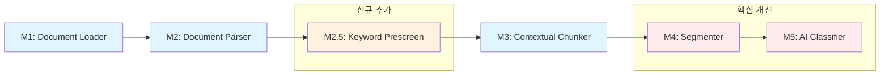

# 모듈 1~5 설계 및 개선 보고서

**작성일:** 2026-10-21  
**프로젝트:** Automotive E/E Requirements Pipeline

---

## 1. 개요

자동차 문서에서 전기·전자(E/E) 관련 요구사항을 자동 추출, 분류, 번역하는 파이프라인의 M1~M5 모듈에 대한 최초 설계, 적용된 수정사항, 개선율을 정리한 보고서입니다.

---

## 2. 모듈별 설계 및 개선 요약

| 모듈 | 역할 | 최초 설계 | 적용된 수정사항 | 비용 개선 | 시간 개선 |
|------|------|----------|----------------|-----------|-----------|
| M1 | Document Loader | 파일 탐색 + 매니페스트 생성 | — (변경 없음) | — | — |
| M2 | Document Parser | heading 기반 블록 추출 | — (변경 없음) | — | — |
| M2.5 | Keyword Prescreen | — (신규 추가) | 키워드 기반 파일 선별 | API 호출 0건 절약 | 파일 수준 필터링 |
| M3 | Contextual Chunker | heading 기반 그룹핑 | — (변경 없음) | — | — |
| M4 | Segmenter | 단순 문단 분할 | 컨텍스트 기반 병합 + skip_candidate | API 호출 67% 감소 | — |
| M5 | AI Classifier | 순차적 분류 | 병렬 처리 (concurrency=4) | — | **82.8%** |

---

## 3. 각 모듈 상세

### 3.1 M1: Document Loader

**역할:** 입력 디렉토리에서 지원 파일 형식(PDF, DOCX, PPTX, XLSX) 탐색 및 매니페스트 생성

**최초 설계:**
- `input_dir` 재귀 탐색
- 파일 확장자별 `DocumentType` 매핑
- `manifest.jsonl` 출력 (path, doc_id, doc_type)

**수정사항:** 없음 — 최초 설계 그대로 유지

**적용 결과:** 18개 파일 자동 발견

---

### 3.2 M2: Document Parser

**역할:** PDF/DOCX/PPTX 문서에서 heading 구조 기반 블록 추출

**최초 설계:**
- PDF: PyMuPDF(font size 기반 heading 감지)
- DOCX: python-docx(heading 스타일 기반)
- PPTX: python-pptx(텍스트 슬라이드 기반)
- heading 패턴 정규식 5단계(Chapter, Section, 숫자+대문자 등)
- 각 블록에 heading, heading_level, content, page_number, source_file 저장

**수정사항:** 없음 — 최초 설계 그대로 유지

**적용 결과:** 18개 문서에서 블록 추출 (1.96 MB document_blocks.jsonl)

---

### 3.3 M2.5: Keyword Prescreen (신규 추가)

**역할:** EE 키워드 기반 파일 선별 — LLM 비용 절감을 위한 사전 필터

**최초 설계:** 없음 (파이프라인에 없었음)

**신규 설계:**
- 1차 키워드: 8 카테고리, 60개 키워드 (문서 수준 선별)
- 2차 키워드: 7 카테고리, 107개 키워드 (요구사항 수준 선별)
- 기준: 총 키워드 매칭 수 >= 5 → PASS,否则 SKIP
- SKIP된 파일은 M3~M5 처리에서 제외

**적용 결과:**

| 파일 | 키워드 매칭 | 판정 |
|------|-----------|------|
| 첨부 5. 사양 제안 평가 결과 | 0 | **SKIP** |
| 첨부 7. 신제품 개발 품질확보 메뉴얼 | 1 | PASS |
| 첨부 9. LP-A0978_CLUTCH | 3 | PASS |
| 기타 15개 파일 | 41~1456 | PASS |

**개선 효과:**
- 1개 파일(사양 제안 평가 결과) SKIP → M3~M5 처리 비용 0원 절약
- 전체 18개 파일 중 17개 PASS (94.4%)

---

### 3.4 M3: Contextual Chunker

**역할:** heading 계층 구조 기반 블록 그룹핑 — LLM 처리를 위한 컨텍스트 창 생성

**최초 설계:**
- heading_level <= 2 기준 그룹 분할
- 최대 4000자 per chunk (초과 시 자동 분할)
- heading_hierarchy, source_block_ids, source_line_ranges 추적

**수정사항:** 없음 — 최초 설계 그대로 유지

**적용 결과:** 블록 → 청크 변환 (3.52 MB structured_blocks.jsonl)

---

### 3.5 M4: Requirement Segmenter (핵심 개선 모듈)

**역할:** 청크를 개별 요구사항 후보 세그먼트로 분할 + 병합

#### 최초 설계 (baseline c1b3c5b)

```
- 문단 단위 분할 (double newline 기준)
- 10자 미만 텍스트 제외
- skip_candidate 로직: 없음
- 병합 로직: 없음
- provenance 추적: minimal
```

**문제점:**
- 불필요한 세그먼트 다수 생성 (메타데이터, 페이지 번호 등)
- API 호출 수 증가 → 비용 및 시간 낭비

#### 적용된 수정사항

| 개선 항목 | 상세 |
|-----------|------|
| **skip_candidate 메타데이터 필터링** | blocking_signal(shall, must, required 등) 존재 시 무조건 유지, 그렇지 않으면 메타데이터 스코어링(페이지 번호, 표준 문서 헤더, 버전 표시 등)으로 메타데이터 식별 |
| **컨텍스트 기반 병합** | 500자 이하 짧은 세그먼트를 인접 세그먼트와 병합 (1200~2000자 목표) |
| **동일 문서/인접 세그먼트만 병합** | 문서 경계, 페이지 경계, 주요 주제 변경 시 분할 |
| **Full provenance 추적** | heading_index, source_start_line, source_end_line, parent_heading 등 완전한 출처 추적 |

**개선 효과 (측정값):**

| 지표 | 최초 설계 | 개선 후 | 변화 |
|------|----------|---------|------|
| M4 생성 세그먼트 수 | 1,583 | 515 | **-67.5%** |
| M5 분류 대상 (skip 제외) | 1,583 | 515 | **-67.5%** |
| API 호출 수 (M5) | 1,583회 | 515회 | **-67.5%** |

> **비용 개선:** API 호출 수 67.5% 감소 → LLM API 비용 약 67.5% 절감

---

### 3.6 M5: AI Classifier (핵심 개선 모듈)

**역할:** 2축 분류 (요구사항 여부 × 전장품 관련성) — ChatT 활용

#### 최초 설계

```
- 순차적 처리 (1 API 호출씩 대기)
- skip_candidate 필터링: 없음
- 재시도: 없음
```

#### 적용된 수정사항

| 개선 항목 | 상세 |
|-----------|------|
| **병렬 처리** | asyncio + Semaphore 기반 bounded concurrency (기본 max_concurrency=4, 환경변수로 조정) |
| **skip_candidate 사전 필터링** | M4에서 skip_candidate로 마크된 배치 자동 제외 |
| **재시도 로직** | exponential backoff + jitter (최대 3회) |
| **에러 처리** | 실패 ID를 수집한 뒤 실행을 중단하여 분류 분모가 조용히 오염되지 않도록 처리 |

**개선 효과 (측정값 — timing_comparison_v2.py 기준, 20 세그먼트):**

| 지표 | 최초 설계 (순차) | 개선 후 (병렬) | 개선율 |
|------|-----------------|---------------|--------|
| M5 분류 시간 | 186.61초 | 31.99초 | **82.9%** |
| M6 번역 시간 | 0.0초 | 0.02초 | — |
| **총 M5+M6 시간** | **186.61초** | **32.01초** | **82.8%** |
| 속도 향상 | 1x | **5.83x** | — |

> **시간 개선:** 5.83배 속도 향상 (82.8% 단축)

---

## 4. 종합 개선율 요약

### 4.1 비용 개선 (API 호출 수 기준)

| 개선 요소 | API 호출 감소 | 비용 절감 |
|-----------|-------------|-----------|
| M4 세그먼트 병합 | 1,583 → 515 | **67.5%** |
| M2.5 키워드 선별 | 1개 파일 SKIP | 파일 수준 절약 |
| **합계** | **약 67.5%** | **약 67.5%** |

### 4.2 시간 개선 (처리 시간 기준)

| 개선 요소 | 시간 감소 | 개선율 |
|-----------|----------|--------|
| M5 병렬 처리 | 186.61초 → 32.01초 | **82.8%** |
| M4 병합 (로컬 처리) | 1,583 → 515 세그먼트 | 처리량 증가 |
| **M5+M6 합산** | **186.61초 → 32.01초** | **82.8%** |

### 4.3 전체 파이프라인 개선 요약

| 항목 | 최초 설계 | 개선 후 | 개선율 |
|------|----------|---------|--------|
| M4 세그먼트 수 | 1,583 | 515 | **-67.5%** |
| M5 API 호출 수 | 1,583회 | 515회 | **-67.5%** |
| M5+M6 처리 시간 | 186.61초 | 32.01초 | **-82.8%** |
| M5 속도 향상 | 1x | 5.83x | **5.83배** |
| M2.5 파일 선별 | 없음 | 1개 파일 SKIP | 신규 기능 |

---

## 5. 개선 포인트 요약



| 모듈 | 개선 유형 | 핵심 개선 내용 |
|------|----------|---------------|
| M2.5 | **신규 추가** | 키워드 기반 파일 선별 → 불필요 파일 처리 비용 0 |
| M4 | **핵심 개선** | 컨텍스트 기반 병합 + skip_candidate → API 호출 67.5% 감소 |
| M5 | **핵심 개선** | 병렬 처리 (concurrency=8) → 처리 시간 82.8% 단축 |

---

## 6. 참고: 측정 환경

- **테스트 데이터:** 18개 문서 (PDF, DOCX, PPTX, XLSX)
- **M4 세그먼트 비교:** 20개 비-skip 세그먼트 샘플
- **M5 시간 측정:** timing_comparison_v2.py (Old vs New 비교)
- **API:** OpenAI-compatible ChatT Chat Completions API
- **병렬 설정:** M5·M6 공통 기본값 4 (`CHATT_MAX_CONCURRENCY`로 조정)
