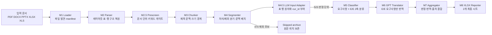

# 자동차 E/E 요구사항 추출 파이프라인 구현 및 개선 종합 보고서

작성일: 2026-10-21

최신 정량 평가 실행본: `output/run_20261021_generalized_v1`

기존 train 기준 실행본: `output/run_20261021_201340`

대상 범위: M1~M8 전체 구현, M2~M4 closed-loop 개선, API 처리 구조, 검증 결과, 발표 구성안

---

## 0. 발표에서 먼저 전달할 핵심 메시지

이 프로젝트는 PDF, DOCX, PPTX, XLSX, XLS 문서에서 자동차 전기·전자(E/E) 관련 요구사항을 찾아내고, 원문 위치를 추적할 수 있는 검토용 Excel로 변환하는 파이프라인이다.

핵심 성과는 단순히 GPT를 호출한 것이 아니라, GPT 앞단에서 원문을 의미 단위로 복원하고 불필요한 입력을 제거하면서도 모든 원문 블록의 처리 경로를 남긴 것이다.

| 핵심 지표 | 결과 | 발표 시 의미 |
|---|---:|---|
| 지원 문서 형식 | 5종 | PDF, DOCX, PPTX, XLSX, XLS 통합 처리 |
| 최신 평가 입력 문서 | 7개 | 기존 train 3개 + holdout test 4개 |
| 파싱된 원문 블록 | 1,433개 | 페이지·슬라이드·행·표·좌표 단위 구조화 |
| M4 라우팅 대상 원문 블록 | 1,162개 | 제목·머리말·꼬리말을 제외한 실제 판정 대상 |
| 원문 블록 라우팅 커버리지 | **1,162/1,162, 100%** | 처리 또는 제외 경로에 누락·중복 없이 배치 |
| M4 문맥 배치 | 289개 | 제목·표·원본 컨테이너 경계를 지킨 문맥 그룹 |
| M4.5 원자 판정 단위 | 523개 | 일반 사양표를 행 단위로 펼치고 안정적인 `cur_id` 부여 |
| 제외·보존 후보 | 470개 | 그림·법적 고지·지원 시트 등을 삭제하지 않고 별도 보존 |
| 단순 블록별 호출 대비 예상 호출 감소 | **55.0%** | 1,162회 가정 대비 M4.5 판정 단위 523회 |
| 처리 세그먼트 병합 감소율 | **58.2%** | 692개 처리 세그먼트를 289개 배치로 병합 |
| AUTOSAR 요구사항 ID 회수 | **16/16** | 기존 0/16 holdout 실패를 일반화 수정으로 복구 |
| XLSX test 요구사항 ID 회수 | **100/100** | 모든 행을 독립 record로 보존 |
| 과대 후보 | **0개** | 2,500자 초과 후보 없음 |
| 문맥 혼합 오류 | **0개** | 제목·타입·표 ID·요구사항 ID 혼합 없음 |
| API 없는 수동 M5·M6 결과 | **393개** | 요구사항 판정·기술 번역 후 M7·M8 입력 완료 |
| 자동화 테스트 | **19 passed** | 모듈 계약·형식 일반화·M4.5·M8 회귀 시나리오 검증 |

> **해석 주의:** 기존 98.06%는 train 3문서에서 측정한 GPT 앞단의 M2~M4 입력 품질 지표다. 최신 7문서 실행에서는 단일 정확도 대신 형식별 holdout anchor와 100% 라우팅 커버리지를 검증했다. GPT 분류 정확도는 별도의 정답 라벨 데이터로 평가해야 한다.

### 30초 발표 요약

> “다양한 형식의 자동차 문서를 바로 GPT에 넣으면 표 구조, 제목 문맥, 페이지 정보가 무너집니다. 본 구현은 구조 타입과 문서 역할을 분리하고, 페이지·슬라이드·표·행 경계를 보존해 입력을 만듭니다. 최신 7문서 실행에서는 1,162개 원문 단위를 누락·중복 없이 라우팅하고, M4.5에서 523개 원자 판정 단위와 안정적인 고객 요구사항 ID를 만들었습니다.”

---

## 1. 프로젝트가 해결하는 문제

자동차 요구사항 문서는 형식과 표현이 일정하지 않다.

- PDF는 읽는 순서, 머리말·꼬리말, 표 셀, 그림 캡션이 섞인다.
- DOCX는 제목 스타일과 일반 문단의 계층을 유지해야 한다.
- PPTX는 한 슬라이드 안에 여러 텍스트 상자가 분산되어 있다.
- XLSX는 요구사항 본문과 검증·추적용 지원 시트가 함께 존재한다.
- 같은 기술 내용도 자연어 문단, 불릿 목록, 표의 한 행으로 표현될 수 있다.
- 원문을 너무 작게 나누면 문맥이 사라지고, 너무 크게 합치면 여러 요구사항이 한 번에 분류된다.
- 모든 원문을 GPT에 보내면 비용과 지연이 증가하며 법적 고지·목차까지 요구사항으로 오인될 수 있다.

따라서 핵심 문제는 다음 두 가지다.

1. **원문을 손실 없이 구조적으로 추출하는 것**
2. **GPT가 판정하기 좋은 의미 단위로 합치되 서로 다른 문맥은 섞지 않는 것**

이 프로젝트는 GPT를 최종 판정 도구로 사용하지만, 품질의 중심은 GPT 앞단의 파싱·구조화·추적성에 둔다.

---

## 2. 설계 원칙

### 2.1 원문 우선

처리에서 제외한 텍스트도 삭제하지 않는다. `requirement_batches.jsonl`에 들어가지 않은 내용은 `skipped_candidates.jsonl`의 `source_segments`에 원문과 위치를 보존한다.

### 2.2 구조 우선

문자 수만으로 자르지 않고 제목, 문서, 블록 타입, 표 ID, 요구사항 ID를 경계로 사용한다.

### 2.3 규칙과 ChatT의 역할 분리

- M1~M4: 결정론적 로컬 처리로 문서 발견, 파싱, 구조화, 후보 생성
- M5~M6: ChatT로 의미 분류와 번역
- M7~M8: 결정론적 집계와 사람 검토용 보고서 생성

API 키가 없어도 M1~M4.5까지 실행하고 입력 품질을 검증할 수 있다. ChatT API는 운영 환경의 M5 분류와 M6 번역에만 필요하다.

### 2.4 추적 가능성

최종 후보에서 원본 문서, 페이지, 좌표, 행 번호, 표, 원본 블록으로 역추적할 수 있도록 식별자를 단계마다 전달한다.

### 2.5 사람의 최종 승인

최종 Excel에는 검토 절차를 별도 시트로 제공한다. AI 결과는 자동 확정값이 아니라 설계 담당자가 확인하는 초안이다.

---

## 3. 전체 아키텍처



### 실행 데이터의 중심 흐름

```text
Manifest entry
  → DocumentBlock
    → ChunkedBlock
      → source segment
        → requirement batch 또는 skipped candidate
          → ClassificationResult
            → TranslationResult
              → SpecRecord
                → final_report.xlsx
```

### 로컬 처리와 ChatT 처리 경계

| 구간 | 실행 방식 | 재현성 | 주요 목적 |
|---|---|---|---|
| M1~M4.5 | 로컬 규칙 기반 | 높음 | 원문 복원, 경계 결정, 표 원자화, 입력량 축소 |
| M5~M6 | OpenAI-compatible ChatT Chat Completions API | 모델·설정에 영향 | 의미 판정, 기술 번역 |
| M7~M8 | 로컬 집계·Excel 생성 | 높음 | 추적 정보 결합, 사람 검토 지원 |

---

## 4. 단계별 데이터와 추적성

### 4.1 `DocumentBlock`: 원문 최소 구조 단위

현재 데이터 모델은 다음 정보를 보존한다.

- 문서·블록 ID: `doc_id`, `block_id`
- 제목 문맥: `heading`, `heading_level`, `heading_index`
- 원문: `content`
- 위치: `page_number`, `source_bbox`, `source_start_line`, `source_end_line`
- 타입: `heading`, `paragraph`, `table`, `figure`, `header`, `footer`, `metadata` 등
- 의미 역할: `section_role` (`content`, `front_matter`, `boilerplate`, `support` 등)
- 원본 컨테이너 경계: `source_unit_id` (페이지·슬라이드·시트 행 등)
- 표 구조: `table_id`, `table_title`, `table_headers`, `table_row_index`
- 요구사항 레코드: `record_id`

### 4.2 `ChunkedBlock`: 제목 문맥을 공유하는 묶음

M3는 원본 블록 배열을 그대로 포함하면서 `combined_content`, 제목 경로, 원본 블록 ID와 행 범위를 추가한다. 따라서 청크가 분할되어도 어떤 블록으로 구성되었는지 잃지 않는다.

### 4.3 M4 배치: GPT 입력 단위

처리 후보에는 다음이 명시적으로 들어간다.

- `batch_id`
- `candidate_type`: `paragraph` 또는 `spec_table`
- `heading`, `heading_index`
- `page_numbers`
- `table_id`, `table_title`
- `record_id`
- `source_unit_id`
- 실제 GPT 입력인 `merged_text`
- 각 원본 블록의 정보가 담긴 `source_segments`

이 구조 덕분에 후속 모듈이 원문 문자열을 다시 정규식으로 해석할 필요가 줄어들었다.

---

## 5. 모듈별 현재 구현과 의미 있는 개선

### 5.1 M1 Loader — 입력 문서 탐색

### 구현

- 입력 폴더를 재귀적으로 탐색한다.
- 확장자를 대소문자와 무관하게 처리한다.
- PDF, DOCX, PPTX, XLSX, XLS를 지원한다.
- 경로를 정렬해 실행마다 동일한 순서를 유지한다.
- 이름이 같은 파일은 `name`, `name__2`와 같이 충돌 없는 결정적 `doc_id`를 부여한다.
- 절대 경로, 문서 ID, 문서 형식을 `manifest.jsonl`에 기록한다.

### 의미

과거에는 같은 파일명을 가진 문서가 후속 단계에서 덮어써질 위험이 있었으나, 현재는 재귀 탐색과 ID 충돌 방지로 배치 실행의 안정성이 높아졌다.

### 5.2 M2 Parser — 이종 문서 구조 복원

M2는 이번 개선에서 가장 큰 비중을 차지한다.

### PDF

- PyMuPDF의 시각 블록과 좌표를 읽고 위에서 아래, 왼쪽에서 오른쪽 순으로 정렬한다.
- 시각 블록의 전체 텍스트, 글자 크기, 굵기, 번호 패턴을 함께 사용해 여러 줄 제목도 탐지한다.
- `30 %`, `5 V` 같은 표 조각이 제목으로 잘못 승격되지 않도록 숫자·단위 중심 문자열을 거른다.
- 여러 페이지의 같은 상·하단 위치에서 반복되는 문자열을 통계적으로 찾아 header/footer로 구분한다.
- `find_tables()`가 찾은 셀 좌표로 표를 행 단위로 재구성한다.
- 셀 값을 `컬럼명: 값`으로 결합해 Symbol/Parameter/Min/Typ/Max/Unit 관계를 보존한다.
- 병합 셀 성격의 앞쪽 열 값은 다음 행에 상속해 문맥 손실을 줄인다.
- 표 제목에서 `table_id`를 만들고 여러 후보로 나뉜 같은 표를 연결한다.
- `Figure N` 캡션과 도형 클러스터를 대조해 그림 영역을 figure로 분리한다.
- Revision history, Legal information, Contents 같은 명시적 비본문 구간에는 `section_role`을 부여하되, 다음 번호형 기술 섹션에서 상태를 해제한다.
- 구조 타입(`table`, `paragraph`)과 의미 역할(`content`, `boilerplate`)을 분리해 표라는 이유만으로 처리하거나 metadata라는 이유만으로 버리는 오류를 막는다.

### DOCX

- Word의 Heading 1~9 스타일을 제목 계층으로 사용한다.
- 문단과 표를 문서에 등장한 순서대로 순회한다.
- 표는 행 단위 블록으로 만들고 헤더와 셀 값을 결합한다.
- 제목 인덱스, 문단 위치, 표·행 위치를 보존한다.

### PPTX

- 제목 placeholder를 우선 사용하고, 없으면 위치·길이를 이용해 상단 제목 후보를 선택한다.
- 그룹 도형을 재귀적으로 순회하고, 표는 행 단위 블록으로 복원한다.
- 본문이 없는 제목 전용 슬라이드도 보존한다.
- 여러 슬라이드에서 반복되는 상·하단 문구는 위치와 빈도로 판정한다.
- `source_unit_id=slide:N`을 부여해 서로 다른 슬라이드가 한 배치로 합쳐지지 않게 한다.

### XLSX

- 워크시트 전체를 하나의 문자열로 만들지 않고, 데이터 행을 각각 독립 블록으로 만든다.
- 헤더와 값을 `헤더: 값` 형태로 결합한다.
- `SYS-INP-001`과 같은 ID를 `record_id`로 보존한다.
- 시트명보다 헤더 스키마와 셀 내용으로 요구사항 시트와 검증·요약 지원 시트를 우선 판정하고, 이름은 보조 신호로만 사용한다.
- 지원 시트도 물리적으로는 table을 유지하고 의미 역할만 `support`로 분리한다.
- 시트 번호, 행 번호, 표 ID를 보존한다.

### XLS

- `pandas`와 `xlrd`로 레거시 워크북을 읽는다.
- XLSX와 같은 공통 행 변환기를 사용해 행 단위 블록, `record_id`, 시트 역할을 동일하게 생성한다.

### 의미

M2의 목표가 “문자열 추출”에서 “페이지·슬라이드·표·행·문맥이 있는 원문 복원”으로 바뀌었다. 형식별 파서는 서로 달라도 M3 이후에는 구조 타입, 의미 역할, 원본 컨테이너 경계라는 같은 계약을 사용한다.

### 5.3 M2.5 Prescreen — 문서 단위 E/E 사전 선별

### 구현

- 설정 파일의 primary·secondary 키워드를 문서 전체에서 검색한다.
- 대소문자를 무시하되 단어 경계를 사용한다.
- 예를 들어 `CAN`이 `candy`에 포함되었다는 이유로 매칭되지 않는다.
- 키워드별 빈도와 범주를 기록한다.
- 임계값 이상 문서는 PASS, 미만 문서는 SKIP 처리한다.
- 파싱 결과가 비어 있는 문서도 manifest를 통해 판정 결과에 남긴다.

### 의미

GPT 호출 전에 명백히 비관련인 문서 전체를 제외할 수 있으며, 왜 통과했는지 키워드 근거를 남긴다.

### 현재 주의점

설정명은 `min_primary_keywords`지만 실제 판정은 primary와 secondary의 **전체 출현 횟수 합계**를 사용한다. 변수명과 실제 정책이 다르므로 운영 정책을 명확히 할 필요가 있다.

### 5.4 M3 Chunker — 제목 기반 문맥 청킹

### 구현

- header와 footer를 청킹 대상에서 제외한다.
- 문서 경계를 절대 넘지 않는다.
- 제목이 바뀌면 새 그룹을 시작한다.
- 최대 4,000자를 기준으로 원본 블록 경계에서 나눈다.
- 한 블록 자체가 4,000자를 넘으면 원본 동일성을 보존하기 위해 강제로 자르지 않는다.
- 청크에 원본 블록 목록과 출처 배열을 유지한다.

### 의미

무작정 고정 길이로 자르는 대신, 기술 제목을 문맥 경계로 사용하면서 모델 입력 크기를 제한한다.

### 5.5 M4 Segmenter — 처리 후보와 제외 후보 생성

M4는 “무엇을 GPT에 보내고 어떤 단위로 합칠 것인가”를 결정한다.

### 블록 단위 판정

과거에는 한 청크에 figure가 포함되면 같은 청크의 정상 문단까지 제외될 수 있었다. 현재는 청크 안의 각 원본 블록을 독립적으로 판정한다.

### 후보 타입

- 일반 본문 → `paragraph`
- 표 행 → `spec_table`
- 문서 메타데이터 → `metadata`
- 그림 영역 → `figure`

### 보수적 제외

- figure와 metadata는 처리 후보에서 분리한다.
- legal information, contents, revision history 같은 boilerplate를 제외한다.
- `shall`, `must`, `required`, `test`, `tolerance`, `시험`, `검증`, `기준` 등의 신호가 있으면 metadata 점수를 강하게 낮춰 과잉 제외를 방지한다.
- 제외된 내용도 원문, 위치, 제외 사유와 함께 저장한다.

### 문맥 병합 경계

다음 중 하나가 바뀌면 배치를 합치지 않는다.

- 문서 ID
- 제목
- 후보 타입
- 표 ID
- 요구사항 레코드 ID

짧은 인접 세그먼트는 약 1,200~2,000자 범위를 목표로 병합한다. 최종 입력에는 `[Heading: ...]`, 필요 시 `[Table: ...]`를 삽입한다.

### 의미

API 호출 수를 줄이면서도 다른 제목, 표, 요구사항 행이 섞이지 않도록 했다. 또한 제외 판단을 “삭제”가 아니라 “별도 경로 보존”으로 구현해 recall 검토가 가능하다.

### 5.6 M4.5 LLM Input Adapter — 원자 판정 단위와 `cur_id`

- M4의 289개 문맥 배치에서 합성 `[Heading]`·`[Table]` 태그와 원문을 분리한다.
- 기존 `record_id`를 우선 사용하고, 표준 대괄호 ID 또는 문서별 결정적 fallback으로 `cur_id`를 만든다.
- 명시적 요구사항 ID가 있는 표는 Description·Rationale 문맥을 함께 유지한다.
- 일반 사양표는 행 단위로 펼치고 표 제목·섹션·상속 필드를 LLM context에 전달한다.
- 최신 실행에서는 289개 문맥 배치를 523개 원자 판정 단위로 변환했다.

이 단계로 M5의 판정 단위, Sheet 1의 요구사항 개수, Sheet 2의 한 행이 같은 의미 단위를 가리키게 되었다.

### 5.7 M5 ChatT Classifier — 2축 요구사항 분류

### 구현

- `httpx` 기반 OpenAI-compatible Chat Completions 요청을 사용한다.
- API key, 주소, 모델은 각각 `CHATT_API_KEY`, `CHATT_BASE_URL`, `CHATT_MODEL` 환경변수로 설정한다.
- 다음 두 축을 분리해 판정한다.
  - 필수 요구사항인가?
  - 자동차 E/E 관련 내용인가?
- E/E 관련이면 Sensor, ECU & Software, Actuator & Motor, Power Electronics, Power & Wiring, Communication & Diagnostics, EMC & Electrical Environment, Other 중 하나로 분류한다.
- JSON 응답 계약을 검증한다.
- fenced JSON이나 앞뒤 설명이 있는 응답도 파싱할 수 있다.
- 비동기 병렬 처리, 세마포어, RPM pacer, `Retry-After` 인식, 지수 백오프를 사용한다.
- 입력 순서와 결과 순서를 유지한다.

### Rate limit 대응

- `CHATT_REQUESTS_PER_MINUTE` 기본값은 60이며 실제 ChatT 한도 이하로 조정한다.
- 요청 시작 시점을 직렬 간격으로 조절해 짧은 순간의 burst를 방지한다.
- 429 응답의 재시도 권고 시간을 읽고 약간의 jitter를 추가한다.
- 파이프라인에서 재시도를 통제한다.

### 중요한 현재 위험

API 호출이 최종 실패하면 실패 ID를 모아 실행을 중단한다. 실패를 `is_requirement=False`, `is_ee_related=False`로 저장하지 않으므로 전체 요구사항 분모와 전장 요구사항 분자가 조용히 오염되지 않는다.

### 5.8 M6 ChatT Translator — 선택적 기술 번역

### 구현

- M5에서 요구사항이면서 E/E 관련으로 판정된 교집합만 번역한다.
- 요구 강도와 자동차 기술 용어를 보존하도록 프롬프트를 구성한다.
- M5와 같은 비동기 병렬 처리, RPM pacing, 재시도 구조를 사용한다.
- 번역이 실패하거나 5자 이하로 지나치게 짧으면 `REVIEW_NEEDED`로 표시한다.

### 의미

모든 분류 결과를 번역하지 않아 API 호출을 줄이고, 최종 보고서에 필요한 항목에만 비용을 사용한다.

### 현재 주의점

번역 QA는 현재 “성공 여부 + 5자 초과” 수준이다. 숫자·단위 보존, 부정 표현, shall/must 강도, 용어집 일치 여부를 자동 검증하지는 않는다.

### 5.9 M7 Aggregator — 판정·번역·출처 결합

### 구현

- 요구사항이면서 E/E 관련인 항목만 최종 `SpecRecord`로 만든다.
- 분류 결과와 번역 결과를 `block_id`로 결합한다.
- `cur_id`, heading, source file, page/slide, table, record, source line, 키워드 근거를 provenance map에서 가져온다.

### 현재 상태

M4.5의 page/slide, table ID, record ID가 M7 `SpecRecord`와 M8 비고까지 전달된다. 배치 ID 대신 고객 요구사항 ID 또는 결정적 fallback을 최종 `cur_id`로 사용한다.

### 5.10 M8 Reporter — 최종 2-sheet Excel 생성

최종 워크북은 다음 두 시트로 구성된다.

| 시트 | 목적 |
|---|---|
| 문서 요약 | 문서별 전장품 관련 여부, 전체 요구사항 수, 전장품 요구사항 수와 비율 |
| 전장 요구사항 | `doc_id`, `cur_id`, 원문, 한글 번역, 비고, 전장품 종류 |

원문과 번역을 자르지 않고 저장하며, 긴 사양은 M4.5에서 행 단위로 원자화한다. 헤더, 줄바꿈, 동적 행 높이, 필터, 틀 고정과 문서별 합계 수식을 적용했다.

---

## 6. Closed-loop 개선 과정

### 6.1 시작 시점의 주요 문제

- PDF가 큰 평면 텍스트 블록으로 추출되어 표·그림·본문이 섞였다.
- 숫자와 단위가 제목으로 오인되었다.
- 그림이 포함된 청크의 정상 본문까지 제외될 수 있었다.
- `7.2 Remote wake-up`, `16.4 Reflow soldering`과 같은 기술 설명이 누락될 위험이 있었다.
- XLSX 워크시트 전체가 하나의 과대 후보가 되었다.
- Requirements와 Verification Matrix가 중복 처리되었다.
- 최종 후보에 heading, page, table ID가 명시적으로 없었다.

### 6.2 Loop 1 — 블록 단위 판정과 PDF 표 구조화

수정 내용:

- M4를 청크 전체 타입 판정에서 원본 블록별 판정으로 변경
- PDF 표 셀 좌표를 이용한 행 단위 구조화
- figure 캡션과 도형 영역 분리
- 후보에 제목, 페이지, 표 ID, 표 제목 추가

결과:

- 그림 옆 정상 기술 문단 복원
- 전기 특성 표의 열 의미 보존
- 표가 여러 후보로 나뉘어도 동일 ID로 연결 가능

### 6.3 Loop 2 — 메타데이터 섹션 상태 유지

수정 내용:

- Revision history, Legal information, Contents를 메타데이터 구간 시작점으로 처리
- 페이지가 바뀌어도 구간 상태 유지
- 다음 정상 기술 제목에서 메타데이터 상태 해제

결과:

- PDF 후반 법적 고지와 목차가 마지막 기술 제목을 상속해 처리 후보로 들어가는 문제 제거

### 6.4 Loop 3 — XLSX 행 단위 원문 보존

수정 내용:

- 워크시트 단위 파싱을 요구사항 행 단위로 변경
- 컬럼명과 값 결합
- Requirement ID를 `record_id`로 보존
- 서로 다른 레코드 ID는 병합 금지

결과:

- 46개 요구사항이 46개 독립 후보로 생성
- 7,930자·13,462자 규모의 워크시트 단일 후보 제거

### 6.5 Loop 4 — 요구사항 시트와 지원 시트 분리

수정 내용:

- Summary, Verification Matrix, Traceability 계열 시트를 metadata로 분리
- 시트 번호를 정렬 축으로 보존
- 지원 시트 내용을 삭제하지 않고 제외 파일에 저장

결과:

- Requirements 46행은 처리 후보
- Verification Matrix 46행과 Summary 13행은 제외·보존
- 원문 대조 155개 판정점에서 98.06% 달성 후 동일 fixture에 대한 반복 튜닝 종료

---

### 6.6 Loop 5 — holdout 실패를 이용한 형식 일반화

train에 없던 AUTOSAR PDF, 요구사항 XLSX, 표 중심 PPTX 두 개를 추가했을 때 다음 구조적 실패가 드러났다.

- AUTOSAR PDF의 제목이 여러 시각 블록으로 갈라져 16개 요구사항 ID가 모두 metadata 상태에 갇혔다.
- PPTX 표 셀 289개가 텍스트 프레임이 아니라는 이유로 누락되고 제목 전용 슬라이드가 사라졌다.
- 같은 제목의 연속 슬라이드가 하나의 배치로 합쳐졌다.
- 물리 구조를 나타내는 `block_type` 하나로 문서 역할까지 표현해 table·metadata 판정이 충돌했다.
- XLS와 XLSX가 서로 다른 출력 단위를 사용했다.

개별 파일명이나 요구사항 문구를 추가하지 않고 다음 공통 계약을 도입했다.

1. `block_type`과 `section_role`을 분리한다.
2. 페이지·슬라이드·행의 원본 경계를 `source_unit_id`로 전달한다.
3. 반복 위치·빈도와 시각 속성으로 제목·머리말·꼬리말을 판정한다.
4. DOCX/PPTX/XLSX/XLS의 표를 공통적으로 행 단위로 표현한다.
5. M4는 역할별 skip 정책을 적용하되 요구사항 신호가 있는 front matter는 복구한다.

### holdout 전후 결과

| 검증 항목 | 수정 전 | 수정 후 |
|---|---:|---:|
| AUTOSAR `RS_ECUR` ID 회수 | 0/16 | **16/16** |
| test XLSX 요구사항 ID 회수 | 100/100 | **100/100** |
| S32K5 PPTX 비어 있지 않은 슬라이드 보존 | 일부 누락 | **35/35** |
| S32K5 PPTX 표 셀 원문 누락 | 289개 대상 미추출 | **0개** |
| VSS PPTX 비어 있지 않은 슬라이드 보존 | 일부 누락 | **16/16** |
| 서로 다른 슬라이드가 한 배치에 혼합 | 2개 배치 | **0개** |
| 기존 train 처리 후보 | 109개 | **109개** |
| 기존 train 후보 타입 | paragraph 39 / table 70 | **동일** |

수정 후 7문서 전체에서는 라우팅 대상 1,162개가 누락·추가·중복 없이 정확히 한 경로에 들어갔다. 이는 M5의 의미 분류 정확도를 뜻하지 않고, M2~M4가 원문을 구조화하고 처리/보존 경로에 배치하는 계약 검증 결과다.

---

## 7. 기존 train 기준선과 회귀 기준: `run_20261021_201340`

### 7.1 입력과 단계별 퍼널

| 단계 | 산출물 | 수량 |
|---|---|---:|
| M1 | 입력 문서 | 3 |
| M2 | `document_blocks.jsonl` | 949 블록 |
| M2.5 | 통과 문서 | 3/3 |
| M2.5 | `prescreen_pass_blocks.jsonl` | 949 블록 |
| M3 | `structured_blocks.jsonl` | 162 청크 |
| M4 | 처리 대상 source segment | 395 |
| M4 | `requirement_batches.jsonl` | 109 배치 |
| M4 | `skipped_candidates.jsonl` | 390 제외 배치 |

M4가 판정해야 하는 원문 블록은 785개다. 제목·머리말·꼬리말을 제외한 이 785개는 처리 후보 또는 제외 후보 중 정확히 한 경로에 들어갔다. 이 절의 수치는 최신 7문서 실행 수치가 아니라 일반화 수정 전후의 회귀 여부를 확인하는 고정 train 기준선이다.

```text
949 parsed blocks
 ├─ 164 heading/header/footer blocks: 구조·문맥 용도로 사용
 └─ 785 M4 routing targets
     ├─ 395 processable source segments
     │   └─ 109 GPT candidate batches
     └─ 390 skipped but preserved candidates
```

### 7.2 문서별 파싱 결과

| 문서 | 원문 형식 | M2 블록 | M3 청크 | 처리 후보 | 제외 후보 |
|---|---|---:|---:|---:|---:|
| AI-EFSV-Demo | PPTX | 9 | 9 | 9 paragraph | 0 |
| TJA1044 | PDF | 835 | 48 | 54 | 331 |
| requirements | XLSX | 105 | 105 | 46 spec_table | 59 |
| **합계** |  | **949** | **162** | **109** | **390** |

### PDF 블록 상세

| 블록 타입 | 수량 |
|---|---:|
| header | 57 |
| heading | 45 |
| paragraph | 56 |
| footer | 62 |
| table | 284 |
| figure | 293 |
| metadata | 38 |
| **합계** | **835** |

PDF가 98개의 큰 텍스트 덩어리에서 835개의 구조 블록으로 세분화된 것은 단순 증가가 아니다. 표 행 284개와 그림 영역 293개를 본문과 분리해 각기 다른 처리 경로를 부여할 수 있게 된 결과다.

### 7.3 처리 후보 구성

| 문서 | paragraph | spec_table | 합계 | 중앙 길이 | 최대 길이 |
|---|---:|---:|---:|---:|---:|
| AI-EFSV-Demo | 9 | 0 | 9 | 442 | 937 |
| TJA1044 | 30 | 24 | 54 | 553.5 | 2,171 |
| requirements | 0 | 46 | 46 | 313 | 404 |
| **합계** | **39** | **70** | **109** | **336** | **2,171** |

전체 후보 길이 분포:

| 구간 | 수량 |
|---|---:|
| 100자 미만 | 2 |
| 200자 미만 | 5 |
| 2,000자 초과 | 12 |
| 2,500자 초과 | **0** |

2,000자를 넘는 12개 후보는 모두 TJA1044의 표 후보이며 최대 2,171자로 제한 범위 안에 있다.

### 7.4 병합 효율

| 문서 | 처리 source segment | 최종 배치 | 감소율 |
|---|---:|---:|---:|
| AI-EFSV-Demo | 9 | 9 | 0.0% |
| TJA1044 | 340 | 54 | **84.1%** |
| requirements | 46 | 46 | 0.0% |
| **합계** | **395** | **109** | **72.4%** |

PPTX는 슬라이드, XLSX는 Requirement ID가 이미 의미 단위이므로 억지로 합치지 않았다. 반면 PDF의 연속 문단과 같은 표 행은 문맥 경계를 지키면서 적극적으로 병합했다.

단순히 785개 원문 블록마다 API를 한 번 호출하는 방식과 비교하면 109개 후보만 전달하므로 예상 호출 수는 **86.1% 감소**한다.

### 7.5 제외 내용

| 문서 | figure | metadata | 합계 |
|---|---:|---:|---:|
| TJA1044 | 293 | 38 | 331 |
| requirements | 0 | 59 | 59 |
| **합계** | **293** | **97** | **390** |

- PDF 제외 331개는 그림 293개와 메타데이터 38개다.
- XLSX 제외 59개는 Verification Matrix 46행과 Summary 13행이다.
- 제외된 source text는 총 42,278자이며 삭제하지 않고 `source_segments`에 보존했다.
- skipped 배치의 `merged_text`는 비어 있고 실제 원문은 `source_segments[].segment_text`에 있다.

이 기준선 이후 제외 사유는 `figure`, `layout_fragment`, `supporting_material`, `document_boilerplate`, `document_metadata`로 세분화했다.

### 7.6 문맥 무결성

| 검사 항목 | 오류 수 |
|---|---:|
| 제목이 없는 처리 후보 | 0 |
| 페이지 정보가 없는 처리 후보 | 0 |
| 서로 다른 제목이 한 배치에 혼합 | 0 |
| paragraph와 spec_table 혼합 | 0 |
| 서로 다른 table ID 혼합 | 0 |
| 서로 다른 record ID 혼합 | 0 |
| 원문 순서 역전 | 0 |
| 배치 ID 불연속 | 0 |

원문 라우팅 결과:

| 지표 | 결과 |
|---|---:|
| 라우팅 대상 블록 | 785 |
| 처리 또는 제외 경로에서 발견 | 785 |
| 누락 | 0 |
| 예상 밖 추가 | 0 |
| 두 번 이상 사용된 block ID | 0 |
| **커버리지** | **100%** |

---

## 8. 동일 PDF 전후 비교

비교 대상은 동일한 `TJA1044.pdf`다.

| 지표 | 초기 실행 `run_20261021_195033` | train 기준선 `run_20261021_201340` | 변화와 해석 |
|---|---:|---:|---|
| M2 블록 | 98 | 835 | 표·그림·본문 구조를 세분화 |
| M3 청크 | 49 | 48 | 청크 수는 거의 유지 |
| GPT 후보 | 30 | 54 | 누락 본문 복원과 표 의미 단위 분리 |
| 제외·보존 후보 | 0 | 331 | 비처리 원문을 명시적으로 추적 |
| 후보 전체 문자 | 61,687 | 51,607 | 불필요 내용 감소, 기술 내용은 복원 |
| 최대 후보 길이 | 6,815 | 2,171 | **68.1% 감소** |
| 200자 미만 청크 | 17 | 3 | **82.4% 감소** |
| 50자 미만 청크 | 12 | 0 | 파편 청크 제거 |
| 법적/목차 boilerplate 후보 | 24 | 0 | GPT 입력 누출 제거 |
| 숫자 조각 오인 제목 | 1 | 0 | 표 조각의 제목 오인 제거 |
| 명시적 heading | 미지원 | 54/54 | 모든 후보에 제목 제공 |
| 명시적 page number | 미지원 | 54/54 | 모든 후보에 페이지 제공 |
| table ID가 있는 후보 | 미지원 | 23 | 분할된 같은 표 연결 가능 |

후보가 30개에서 54개로 늘어난 것을 성능 악화로 보면 안 된다. 초기에는 하나의 큰 후보에 여러 표·문단이 섞였고 정상 기술 본문도 누락되었다. 최신 결과는 과대 후보를 줄이고 복원된 본문과 구조화된 표를 별도 의미 단위로 만든 결과다.

### Closed-loop 직전 v5와 최종 비교

| 지표 | v5 | 최종 | 의미 |
|---|---:|---:|---|
| PDF 처리 후보 | 37 | 54 | 누락 기술 본문 복원 |
| paragraph 후보 | 22 | 30 | figure 동반 본문 복원 |
| spec_table 후보 | 15 | 24 | 표 행·열 의미 보존 강화 |
| 제외 후보 | 366 | 331 | 청크 전체 오제외 감소 |
| 후보 문자 수 | 32,531 | 51,607 | 유효 기술 내용 복원 |
| 후보 중앙 길이 | 722 | 553.5 | 더 작고 균일한 의미 단위 |
| 명시적 heading | 0/37 | 54/54 | 후속 재파싱 제거 |
| table ID 후보 | 0 | 23 | 표 추적 가능 |

---

## 9. 원문 대조 평가와 종료 조건

평가는 코드 규칙이 자기 자신과 일치하는지를 세지 않고, 원본 문서에서 사람이 정한 판정점을 출력에서 직접 찾는 방식으로 수행했다.

| 평가 범주 | 판정점 | 기대 결과 |
|---|---:|---|
| XLSX Requirements 행 | 46 | 각 ID별 독립 spec_table 후보 |
| XLSX Verification Matrix 행 | 46 | metadata로 제외·보존 |
| PDF Table 1~12 | 12 | 기술 표 처리, revision 표 제외 |
| PDF Figure 1~11 | 11 | figure로 제외·보존 |
| PDF 기술 문단·섹션 | 24 | paragraph 후보 |
| PDF 메타데이터 | 7 | 법적 정보·목차·개정 이력 제외 |
| PPTX 슬라이드 | 9 | 슬라이드별 paragraph 후보 |
| **합계** | **155** | |

| 결과 | 수량 |
|---|---:|
| 일치 | 152 |
| 불일치 | 3 |
| 보수적 정확도 | **98.06%** |

3개 불일치는 처리 후보 오유입이 아니다. `Table 12. Revision history`, `Contents`, `All rights reserved`가 처리 후보에는 들어가지 않았지만 heading 또는 footer 단계에서 제거되어 `skipped_candidates.jsonl`에 같은 문자열의 본문 레코드로 남지 않은 추적 방식 차이를 보수적으로 실패 처리했다.

사전에 정한 종료 조건 90%를 넘었으므로 동일 문서에 대한 closed-loop는 중단했다. 이후에는 같은 문서의 정규식을 더 추가하기보다 보지 않은 문서로 일반화 성능을 측정해야 한다.

---

## 10. API 성능 개선과 운영 안정성

### 10.1 현재 구조의 비용 절감 지점

API 비용은 세 단계에서 줄어든다.

1. M2.5가 비관련 문서 전체를 제외한다.
2. M4가 그림·메타데이터를 제외한다.
3. M4가 같은 문맥의 짧은 세그먼트를 하나의 배치로 병합한다.

기존 train 3문서 실행에서는 785개 라우팅 대상이 109개 M4 배치로 줄어 86.1% 감소했다. 최신 7문서에서는 1,162개 대상을 M4가 289개 문맥 배치로 만들고, M4.5가 일반 사양표를 원자화해 523개 판정 단위로 변환했다. 자동 M5 호출 기준 감소율은 55.0%이며, 요구사항 수를 과소계수하지 않는 대신 표의 각 검증 가능한 사양을 독립 판정한다.

### 10.2 과거 18문서 속도 벤치마크

아래 결과는 현재 7문서 품질 평가와 다른 과거 18문서 실험이다. 동일 표에서 섞어 해석하면 안 된다.

| 지표 | 개선 전 | 개선 후 | 변화 |
|---|---:|---:|---:|
| M4 세그먼트/분류 대상 | 1,583 | 515 | 67.5% 감소 |
| M5 분류 시간 | 186.61초 | 31.99초 | 82.9% 단축 |
| M5+M6 합계 | 186.61초 | 32.01초 | 82.8% 단축 |
| 상대 속도 | 1.0x | 5.83x | 5.83배 |

이 벤치마크는 당시 데이터와 API 조건에서 측정된 역사적 결과다. 현재 RPM pacing 설정에서는 계정 한도, 모델 지연, 재시도 발생에 따라 실제 시간이 달라진다.

### 10.3 운영 파라미터

| 설정 | 기본값 | 역할 |
|---|---:|---|
| `CHATT_MODEL` | 환경 설정값 | M5·M6 모델 선택 |
| `CHATT_BASE_URL` | 환경 설정값 | ChatT Chat Completions 주소 구성 |
| `CHATT_REQUESTS_PER_MINUTE` | 60 | 서비스 RPM 아래에서 요청 간격 제어 |
| `request_timeout` | 60초 | 개별 요청 제한 |
| `max_concurrency` | 4 | 동시 작업 상한; 서비스 검증 후 8로 조정 가능 |
| `max_retries` | 3 | 일시 오류 재시도 횟수 |

결제 여부와 RPM 제한은 별개다. 사용 계층과 모델별 한도가 실제 처리량을 결정하며, 코드의 RPM 값은 계정 한도를 높이는 것이 아니라 그 한도 아래에서 429를 피하도록 요청을 조절한다.

---

## 11. 테스트와 검증 상태

### 자동 테스트 19개

| 영역 | 검증 내용 |
|---|---|
| M1 | 같은 stem의 문서 ID가 결정적이고 고유한지 |
| M2 DOCX | 제목 provenance와 표 행 순서가 유지되는지 |
| M2 PDF heading | 표의 숫자 조각을 제목으로 오인하지 않고 여러 줄 제목을 인식하는지 |
| M2 PPTX | 제목 전용 슬라이드와 표 셀을 보존하는지 |
| M2 XLSX | 요구사항 행과 record ID가 원자적으로 유지되고 지원 시트를 스키마로 판정하는지 |
| M2.5 | `CAN`이 `candy`에 부분 일치하지 않는지 |
| M3 | 서로 다른 문서·원본 컨테이너를 한 청크로 합치지 않는지 |
| M4 | 배치·세그먼트 ID가 고유한지 |
| M4 | figure와 정상 문단이 같은 청크에 있어도 개별 판정되는지 |
| M4 | 물리 타입과 의미 역할을 분리하고 요구사항 신호가 있는 front matter를 복구하는지 |
| M4 | 서로 다른 슬라이드가 같은 제목이어도 병합하지 않는지 |
| M4.5 | 기존 record ID를 `cur_id`로 보존하고 원문 필드를 정리하는지 |
| M4.5 | 일반 사양표를 행 단위로 원자화하면서 부모 배치와 문맥을 보존하는지 |
| M5 | fenced JSON을 정상 파싱하는지 |
| M6 | 지나치게 짧은 번역을 REVIEW_NEEDED로 표시하는지 |
| API adapter | 설정 모델과 M5·M6 계약을 지키는지 |
| M7·M8 | provenance 결합과 요청된 2개 Excel 시트·집계값을 보장하는지 |

### 최신 검증 결과

- `pytest -q`: **21 passed**
- `ruff check src tests scripts`: **All checks passed**
- JSONL 집계 및 구조 검사: 통과
- 테스트 중 PyMuPDF의 `fitz` 호환 import에 대한 deprecation/future warning이 발생한다.

자동 테스트는 회귀 방지에는 유효하지만, 실제 ChatT 서버를 호출하는 통합 테스트와 대규모 정답 라벨 기반 분류 평가는 포함하지 않는다.

---

## 12. 현재 장점

### 12.1 원문 손실을 확인할 수 있다

처리 후보뿐 아니라 제외 후보까지 위치와 함께 남기므로 누락 원인을 조사할 수 있다.

### 12.2 이종 문서를 공통 모델로 통합했다

PDF 페이지, PPTX 슬라이드, XLSX 행을 `DocumentBlock`이라는 공통 단위로 정규화했다.

### 12.3 GPT 입력의 문맥 품질이 높아졌다

모든 처리 후보에 제목과 페이지가 있고, 서로 다른 제목·표·레코드가 섞인 배치가 없다.

### 12.4 비용과 품질을 함께 다뤘다

제외와 병합으로 호출 수를 줄이되, 요구사항 신호가 있는 문장을 metadata로 과잉 제외하지 않도록 방어한다.

### 12.5 단계별 산출물로 디버깅할 수 있다

각 모듈이 JSONL을 남기므로 어느 단계에서 원문이 변했는지 추적하기 쉽다.

### 12.6 실패 격리가 되어 있다

개별 API 요청 실패가 전체 실행을 즉시 중단시키지 않으며, reasoning 또는 REVIEW_NEEDED로 흔적을 남긴다.

---

## 13. 한계, 과적합 위험, 발표 시 정직하게 말해야 할 점

### 13.1 98.06%는 in-sample 입력 품질 평가다

closed-loop에서 확인한 문서와 개선에 사용한 문서가 같으므로 98.06% 자체는 일반화 정확도가 아니다. 이번에는 별도 test 4문서에서 형식별 anchor를 측정해 AUTOSAR ID 16/16, XLSX ID 100/100, PPTX 비어 있지 않은 슬라이드 51/51과 표 셀 누락 0건을 확인했다. 다만 7문서만으로 모든 공급사·서식의 통계적 정확도를 주장할 수는 없다.

### 13.2 휴리스틱은 남아 있지만 파일별 문자열 의존은 줄였다

- PDF header/footer는 특정 공급사 문자열 대신 여러 페이지의 반복 위치와 빈도를 사용한다.
- XLSX/XLS 지원 시트는 헤더 스키마와 내용 신호를 우선 사용하고 시트명은 fallback으로만 사용한다.
- 제목 판정, 표 복원, front matter 종료에는 임계값과 패턴이 있으므로 완전히 학습 기반인 것은 아니다.

핵심 규칙은 파일명이 아니라 문서 구조를 대상으로 하지만, 새로운 레이아웃의 holdout을 계속 추가해 임계값 민감도를 확인해야 한다.

### 13.3 형식별 잔여 한계

- DOCX와 PPTX 표는 행 단위로 복원하지만 복잡한 병합 셀의 의미 계층은 완전하지 않을 수 있다.
- PPTX 일반 텍스트는 슬라이드 경계를 지키지만 한 텍스트 상자 안의 복수 독립 요구사항을 항상 분리하지는 않는다.
- XLS는 XLSX와 같은 행 단위 계약으로 통합했지만 저장소에 실제 `.xls` holdout fixture가 없어 실파일 회귀 검증이 추가로 필요하다.
- PDF의 복잡한 병합 셀이나 선이 없는 표는 완전히 복원되지 않을 수 있다.
- 스캔 PDF와 그림 내부 텍스트·시각적 의미는 OCR/비전 단계가 없으므로 기본적으로 제외된다.

### 13.4 M4는 recall 우선의 보수적 후보 생성기다

제목 전용 슬라이드도 원문 보존을 위해 M4 후보가 될 수 있다. M4는 의미 분류를 확정하는 단계가 아니므로 M5가 non-requirement로 거르는 설계이며, recall을 유지하는 대신 일부 불필요한 API 호출이 남는다.

### 13.5 API 실패와 실제 음성 판정이 구분되지 않는다

M5 최종 실패를 `False/False`로 기록하는 현재 정책은 가장 중요한 운영 위험이다. 오류 상태를 별도 필드로 분리하지 않으면 rate limit이나 네트워크 장애가 요구사항 누락으로 보일 수 있다.

### 13.6 M4.5 원자화의 개수 정의를 명시해야 한다

최종 요구사항 수는 문장 수가 아니라 “명시적 요구사항 레코드 또는 일반 사양표의 데이터 행” 수다. 데이터시트의 min/typ/max 한 행도 하나의 검증 가능한 사양으로 계산하므로, 발표와 보고서에서 이 단위를 명시해야 한다.

### 13.7 라우팅 정확도와 의미 분류 정확도는 다르다

최신 실행의 100%는 모든 대상 원문이 처리 또는 보존 경로에 누락 없이 들어갔다는 뜻이다. 실제 요구사항/비요구사항 및 E/E/non-E/E 정확도는 정답 라벨과 M5 실행 결과로 별도 측정해야 한다.

---

## 14. 복잡성 대비 다음 수정의 우선순위

동일 fixture에서 정규식을 계속 추가하는 것은 효율이 낮고 과적합 위험이 높다. 다음 단계는 “더 복잡한 규칙”보다 “오류 상태 분리와 외부 검증”에 우선순위를 두는 것이 좋다.

| 우선순위 | 작업 | 기대 효과 | 복잡성 | 권고 |
|---|---|---|---|---|
| P0 | M5 API 실패를 `ERROR`로 분리하고 재처리 가능하게 저장 | 거짓 음성 방지 | 낮음 | 즉시 |
| P0 | M7 provenance에 page/table/record 정보 전달 | 최종 보고서 추적성 완성 | 낮음 | 즉시 |
| P0 | 더 많은 공급사·스캔 PDF·실제 XLS로 holdout 확대 | 일반화 범위 정량화 | 중간 | 즉시 |
| P1 | 제목·표·시트 역할의 판정 근거를 진단 필드로 저장 | 실패 설명과 임계값 조정 | 낮음 | 권장 |
| P1 | 번역의 숫자·단위·부정·의무 강도 QA | 번역 신뢰도 향상 | 중간 | 권장 |
| P2 | PPTX 텍스트 상자 내부 요구사항 세분화 | 불필요 호출 및 혼합 감소 | 중간 | 실제 오류가 확인될 때 |
| P3 | 그림 OCR/비전 분석 | 회로도·타이밍도 요구사항 복원 | 높음 | 실제 누락 근거가 있을 때 |
| P3 | 복잡한 병합 셀 전용 복원기 | 표 정확도 향상 | 높음 | 문제 문서가 충분할 때 |

### 권장 stop 기준

현재 fixture에 대한 M2~M4 튜닝은 98.06%에서 중단하는 것이 맞다. 다음 개발 사이클은 최소 다음 조건으로 진행하는 것이 좋다.

1. 공급사·레이아웃·형식이 다른 holdout 문서 확보
2. 원문 판정점 사전 작성
3. 코드 변경 전 baseline 고정
4. parsing, routing, requirement classification을 각각 별도 지표로 평가
5. holdout 90% 이상이면서 기존 fixture 회귀가 없을 때 채택

---

## 15. 발표 슬라이드 구성안

### 슬라이드 1 — 문제 정의

**제목:** “GPT보다 먼저 해결해야 했던 문제: 문서를 어떻게 읽을 것인가”

핵심 문구:

- PDF 표·그림·머리말이 평면 텍스트로 섞임
- Excel 요구사항과 검증 시트가 중복됨
- 너무 작은 조각은 문맥 손실, 너무 큰 조각은 요구사항 혼합

추천 시각 자료: 초기 6,815자 후보와 최신 2,171자 후보 비교.

### 슬라이드 2 — 목표

**제목:** “원문 보존 + 의미 단위 병합 + 추적 가능한 결과”

세 문장:

1. 원문을 구조적으로 복원한다.
2. GPT가 판정할 단위로 묶는다.
3. 처리하지 않은 내용도 근거와 함께 보존한다.

### 슬라이드 3 — 전체 파이프라인

M1~M8 아키텍처 다이어그램을 사용한다. M1~M4/M7~M8은 로컬 결정론 처리, M5~M6만 GPT라는 점을 색으로 구분한다.

### 슬라이드 4 — 핵심 데이터 구조

`DocumentBlock → ChunkedBlock → Batch → SpecRecord` 흐름과 page, bbox, table_id, record_id가 전달되는 모습을 보여준다.

### 슬라이드 5 — PDF 개선

**Before:** 98개 평면 블록, 표·그림·본문 혼합

**After:** 835개 구조 블록, table 284개, figure 293개, paragraph 56개

발표 포인트: 블록 수 증가가 데이터 팽창이 아니라 구조 복원이라는 점.

### 슬라이드 6 — Excel 개선

**Before:** 워크시트 전체가 7,930자 또는 13,462자 후보

**After:** Requirements 46행 → 46개 후보, Verification Matrix 46행 → 제외·보존

### 슬라이드 7 — Closed-loop와 holdout

train 개선 뒤 보지 않은 형식에서 실패를 찾고 공통 계약으로 수정한 흐름을 표시한다.

```text
블록 판정·표 복원
  → 메타데이터 상태
    → XLSX 행 단위
      → 지원 시트 분리
        → train 98.06%에서 stop
          → holdout 실패 분석
            → role/source-unit 공통 계약
```

### 슬라이드 8 — 정량 성과

큰 숫자 네 개만 배치한다.

- **1,162/1,162** 원문 라우팅
- **289** GPT 후보
- **55.0%** M4.5 기준 예상 호출 감소
- **16/16 + 100/100** holdout ID 회수

하단 주석: “GPT 분류 정확도가 아닌 입력 파싱·라우팅 및 형식별 anchor 결과”.

### 슬라이드 9 — 문맥 품질

다음 0건 지표를 보여준다.

- mixed heading 0
- mixed candidate type 0
- mixed table ID 0
- mixed record ID 0
- 2,500자 초과 0

### 슬라이드 10 — GPT 활용 방식

- strict JSON Schema 기반 2축 분류
- E/E 요구사항만 선택 번역
- concurrency + RPM pacing + retry
- 최종 Excel에서 사람 검토

### 슬라이드 11 — 한계와 과적합 통제

- 98.06%는 in-sample이고 holdout도 4문서 규모
- 구조 휴리스틱의 임계값은 추가 형식에서 검증 필요
- API 실패와 음성 판정 분리 필요
- 실제 legacy XLS와 스캔 PDF 검증 필요

### 슬라이드 12 — 결론과 다음 단계

결론:

> “GPT 자체보다 입력을 신뢰 가능한 구조로 만드는 것이 요구사항 추출 품질과 비용을 동시에 결정했다.”

다음 단계:

1. 더 넓은 holdout과 라벨셋 평가
2. API 오류 상태 분리
3. 최종 보고서 provenance 완성

---

## 16. 데모 시나리오

발표 중 실제 파일을 보여줄 경우 다음 순서가 가장 이해하기 쉽다.

1. `document_blocks.jsonl`에서 TJA1044 표 행 하나를 보여준다.
   - `page_number`, `source_bbox`, `table_id`, `table_headers` 강조
2. `requirement_batches.jsonl`에서 같은 표가 `[Heading]`, `[Table]` 문맥과 함께 합쳐진 모습을 보여준다.
3. `skipped_candidates.jsonl`에서 figure 또는 Verification Matrix가 삭제되지 않고 보존된 모습을 보여준다.
4. requirements XLSX의 Requirement ID 하나가 `record_id`로 독립 유지된 모습을 보여준다.
5. 마지막으로 M8의 문서 요약과 전장 요구사항 시트를 보여준다.

### 발표 중 예상 질문과 답변

**Q. 왜 전부 GPT에 넣지 않았나?**

A. 표 구조와 출처를 잃고 불필요한 토큰·호출이 증가한다. 최신 7문서 실행은 1,162개 대상을 523개 원자 판정 단위로 줄이면서 모든 원문의 경로와 표 행 단위를 보존한다.

**Q. 98.06%가 분류 정확도인가?**

A. 아니다. M2~M4가 원문을 올바르게 파싱하고 처리·제외했는지의 정확도다. GPT 분류 정확도는 정답 라벨 데이터로 별도 평가해야 한다.

**Q. rule-based라서 특정 문서에만 맞는 것 아닌가?**

A. 그래서 특정 공급사 문자열 대신 반복 위치·빈도, 시각 속성, 컬럼 스키마를 사용하고 구조 타입과 의미 역할을 분리했다. 별도 4문서 holdout에서 기존의 AUTOSAR 0/16 실패를 16/16으로 복구하면서 train 후보 109개와 타입 분포를 그대로 유지했다. 다만 표본이 작아 추가 holdout은 계속 필요하다.

**Q. 제외된 내용은 잃어버리는가?**

A. 아니다. `skipped_candidates.jsonl`의 `source_segments`에 원문, 위치, 타입, 사유를 보존한다.

**Q. API rate limit이 발생하면 어떻게 되는가?**

A. RPM pacing과 재시도를 적용했다. 다만 최종 실패가 현재 False/False로 기록되는 문제는 운영 전 ERROR 상태로 분리해야 한다.

---

## 17. 구현 규모와 저장소 상태

이번 일반화 수정의 핵심 변경 파일은 공통 모델, M2 파서, M3 청커, M4 세그멘터, 모듈 테스트다. 변경 줄 수보다 자동 테스트, 원문 라우팅 커버리지, train 회귀, holdout anchor를 품질 기준으로 사용했다.

---

## 18. 산출물 안내

### 최신 M1~M8 실행 파일

| 파일 | 내용 |
|---|---|
| `output/run_20261021_generalized_v1/manifest.jsonl` | train 3개 + holdout 4개 입력 문서 목록 |
| `document_blocks.jsonl` | M2 원문 구조 블록 1,433개 |
| `prescreen_results.jsonl` | 문서별 키워드와 PASS/SKIP |
| `prescreen_pass_blocks.jsonl` | 통과 문서 블록 |
| `structured_blocks.jsonl` | M3 문맥 청크 353개 |
| `requirement_batches.jsonl` | M4 문맥 배치 289개 |
| `skipped_candidates.jsonl` | 제외·보존 후보 470개 |
| `llm_inputs.jsonl` | M4.5 원자 판정 레코드 523개 |
| `classifications.jsonl` | API 없이 직접 검토한 523개 2축 판정 |
| `translated.jsonl` | 전장 요구사항 393개 한글 번역 |
| `spec_records.jsonl` | M7 최종 전장 요구사항 393개 |
| `final_electrical_requirements.xlsx` | 문서 요약 + 전장 요구사항 최종 2-sheet 보고서 |

이 표에 적힌 과거 M5·M6 결과는 외부 API를 호출하지 않고 직접 검토해 생성한 결과다. 따라서 393개는 당시 판정 결과이며 정답 라벨 대비 모델 정확도 수치가 아니다. 최신 3개 문서 검증 결과는 별도 실행 폴더의 보고서를 기준으로 한다.

### 관련 기존 보고서

- `m2_m4_improvement_report.md`: 초기 M2~M4 개선 전후 분석
- `m2_m4_closed_loop_report.md`: 4회 closed-loop와 98.06% 종료 근거
- `module1-5_report.md`: 초기 M1~M5 구조와 과거 18문서 속도 벤치마크

---

## 19. 재현 명령

### 전체 실행

```bash
conda activate elecreq
export CHATT_API_KEY="YOUR_API_KEY"
export CHATT_BASE_URL="https://YOUR_CHATT_SERVER"
export CHATT_MODEL="YOUR_MODEL"
export CHATT_MAX_CONCURRENCY="4"
export CHATT_REQUESTS_PER_MINUTE="60"
python -m ee_pipeline.cli run --input data/input --output output
```

### M1~M4만 단계 실행

```bash
python -m ee_pipeline.cli m1 --input data/input --output output
python -m ee_pipeline.cli m2 --input data/input --output output
python -m ee_pipeline.cli m25 --output output
python -m ee_pipeline.cli m3 --output output
python -m ee_pipeline.cli m4 --output output
python -m ee_pipeline.cli m45 --output output
```

### 검증

```bash
pytest -q
ruff check src tests
```

---

## 20. 최종 결론

현재 구현의 가장 의미 있는 성과는 다음 세 가지다.

1. **원문 복원:** PDF·DOCX·PPTX·XLSX·XLS를 위치와 구조가 있는 공통 데이터 모델로 변환하고 표를 행 단위로 보존했다.
2. **의미 단위 입력:** 물리 구조와 의미 역할, 원본 컨테이너 경계를 분리하고 M4.5에서 1,162개 대상을 523개 원자 판정 단위로 만들었다.
3. **일반화 검증:** 기존 train 후보 109개와 타입 분포를 유지하면서 holdout AUTOSAR ID 16/16, XLSX ID 100/100, PPTX 표 셀 누락 0건을 확인했다.

개별 파일을 겨냥한 규칙 추가 대신 모든 형식이 공유하는 구조 계약을 고쳤기 때문에 holdout 복구와 train 무회귀를 동시에 달성했다. 다음 성숙도 단계는 더 넓은 공급사·스캔 PDF·실제 XLS holdout, API 오류 상태 분리, M7~M8 provenance 완성이다.
